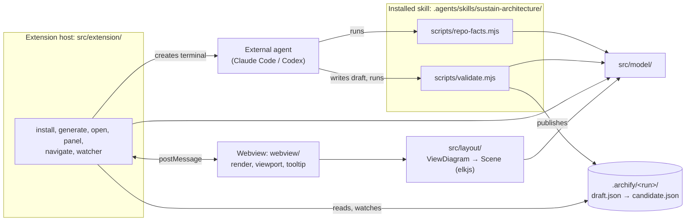
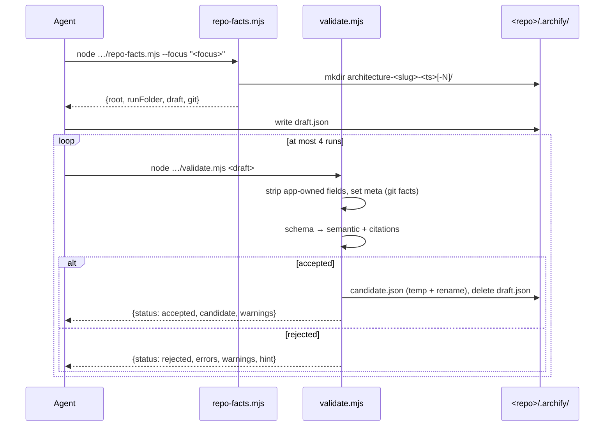
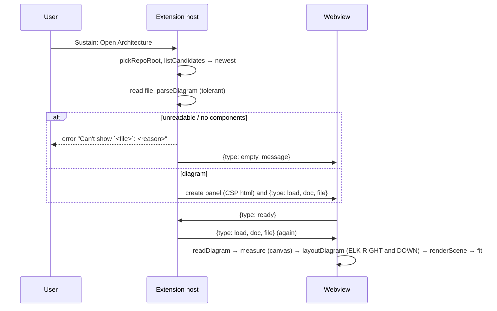

# Sustain architecture

Sustain is a VS Code extension that shows a repository's architecture as an Archify diagram and opens the code cited by each node. Diagrams are produced by an external coding agent (Claude Code or Codex) running the bundled `sustain-architecture` skill, whose scripts validate and publish the diagram; the extension itself never calls an LLM ([ADR 0002](adr/0002-external-coding-agent-generates-diagrams.md)).

## Components



## Modules

### `src/model/`

Pure TypeScript shared by the scripts, the extension host and the webview. No `vscode` import anywhere.

| File | Responsibility | Node APIs |
|---|---|---|
| `types.ts` | Archify v1 types (`ArchifyDoc`, `Component`, `SourceRef`, …), `Issue {code, pointer, message}`, `stringifyDocument` (2-space JSON + newline), `pointerToken`. Documents stay plain parsed JSON, so unmodelled fields survive rewrites (FR-MOD-01). | none (browser-safe) |
| `schema.ts` | `validateArchitecture(value)`: Ajv draft 2020-12 (`ajv/dist/2020`, `allErrors`, `strict: false`) over the vendored `schemas/*.schema.json`, `$ref`s resolved by `$id` in memory; errors → `Issue` with JSON pointers (FR-MOD-02). | none |
| `checks.ts` | `semanticChecks(doc)`: duplicate IDs, unknown references, missing sources, overlapping/equal boundaries; `boundaryRelation` (FR-VAL-04). | none (browser-safe) |
| `deny.ts` | `isDenied(path)`: citation deny-list, any segment, case-insensitive (FR-VAL-05). | none |
| `citations.ts` | `citationPathOk`, `countLines`, `probeFile(rootReal, path)` (real-path confinement, regular file, ≤ 2 MiB, NUL sniff), `rangeProblem`, `checkCitations(doc, root)` (FR-VAL-05). | `node:fs`, `node:path` |
| `git.ts` | `collectGitFacts(root)` via fixed-argv `git` with `GIT_TERMINAL_PROMPT=0`; `sanitizeOrigin`, `parsePorcelainZ`, `repositoryFromGit` (FR-GIT-01). | `node:child_process`, `node:fs` |
| `runFolder.ts` | `slugify`, `runTimestamp`, `RUN_FOLDER_PATTERN`/`parseRunFolderName`, `createRunFolder` (collision `-N`), `locateDraft`, `publishCandidate` (temp + rename, then delete draft) (FR-RF-01, FR-VAL-06). | `node:fs`, `node:path` |
| `submission.ts` | `applyAppOwnedFields` (step 1, FR-VAL-02) and `checkSubmission(value, app, checkCitations)`: schema, then semantic + injected citation check (FR-VAL-03..06). | none (file access injected) |
| `tolerant.ts` | `readDiagram(value)` / `parseDiagram(text)` → `ViewDiagram` (FR-VIEW-03): skips components without a string id and duplicates, label falls back to id, unknown type → `external`, drops unresolved connections and boundary members, skips emptied boundaries and sources without a string path; reports skips as `<pointer>: <reason>`. | none (browser-safe) |
| `discovery.ts` | `listCandidates(root)`: `.archify/*/candidate.json` inside the root, newest first (`compareCandidates`, FR-VIEW-02); `repoRootFor(file, folder)`. | `node:fs`, `node:path` |
| `session.ts` | Learning-session model (ADRs 0029–0035, 0037): `SessionPhase`/`SessionState` (`session.json`), `Manifest`/`ManifestBug` (`manifest.json`), `EventType` + `appendEvent` (`events.jsonl`), the `.sustain/active` lock helpers, step/score tables (`TIER_POINTS`, `HINT_COST`, `KIND_TIER`) and the checked load/save pair (temp + rename writes). | `node:fs`, `node:path` |
| `leaderboard.ts` | `parseLedger` (tolerant `events.jsonl`), `leaderboardEntry` (one ranked row per run: status, score, bug counters, hint cost), `rankLeaderboard` — pure aggregation for the session panel ([ADR 0034](adr/0034-sustain-folder-layout-and-session-state-files.md), [ADR 0040](adr/0040-hooks-merge-panel-read-side-and-devin-detection.md)). | none |
| `messages.ts` | `HostMessage` / `WebviewMessage` plus `SessionView` / `SessionHostMessage` / `SessionWebviewMessage` types (protocol below). | none |

### `src/agent/`

CLI entry points bundled by `esbuild.mjs` into `dist/skills/<skill>/scripts/*.mjs` (ESM, platform node, target node18, dependencies inlined; [ADR 0007](adr/0007-validator-as-dependency-free-node-bundles.md)).

* `repo-facts.ts` → `repo-facts.mjs [--focus <text>]`: creates the run folder, prints `{root, runFolder, draft, git}` ([ADR 0018](adr/0018-repo-facts-creates-the-run-folder.md)).
* `validate.ts` → `validate.mjs <draft>`: locate draft → parse → git facts → `checkSubmission` → publish or report ([ADR 0017](adr/0017-validator-output-contract-and-exit-codes.md), [ADR 0019](adr/0019-validator-deviations-from-the-prototype-gate.md)).
* `session.ts` → `session.mjs <command>` (`dist/skills/sustain-bugfix/scripts/`): the learning-session referee — `init`, `plan`, `inject`, `status`, `report`, `hint`, `verify`, `complete`, `pause`, `resume`, `restore`, `abandon` over `.sustain/<run>/` ([ADR 0030](adr/0030-session-state-machine-as-bundled-scripts.md), [ADR 0037](adr/0037-session-command-contract-and-scoring.md), [ADR 0039](adr/0039-lifecycle-commands-and-hook-contract.md)).
* `session-hook.ts` → `session-hook.mjs` (same folder): the Devin lifecycle hook wired from `.devin/hooks.v1.json` — blocks `edit`/`write`/`apply_patch`/`notebook_edit`/`run_subagent` while `phase === "hunting"` (exit 2 + `decision: block`) and re-injects session state as `additionalContext` on `UserPromptSubmit`/`PostCompaction`/`SessionStart`; inert otherwise ([ADR 0032](adr/0032-hunt-phase-enforcement-via-devin-hooks.md), [ADR 0039](adr/0039-lifecycle-commands-and-hook-contract.md)).
* `modes/bugfix/mutations.ts`: the deterministic mutation engine — ordered rewrite tables for `off-by-one`, `flipped-comparison`, `missing-await` over a string/comment-aware line mask, `mutateText`/`mutateFile`, `bugStillPresent`, `restoreHunk` ([ADR 0031](adr/0031-mutation-engine-seeds-the-bugs.md), [ADR 0038](adr/0038-mutation-engine-v1-rule-tables.md)).

### `skills/sustain-architecture/`

The static skill, copied as-is to `dist/skills/sustain-architecture/` next to the built scripts ([ADR 0004](adr/0004-one-skill-with-bundled-scripts.md), [ADR 0005](adr/0005-manual-invocation-and-claude-pre-approvals.md)).

* `SKILL.md`: frontmatter (manual invocation, Claude pre-approvals) and the seven imperative steps of FR-SKL-02; every script is referenced by its repo-root path `.agents/skills/sustain-architecture/scripts/…`.
* `agents/openai.yaml`: Codex display name and `allow_implicit_invocation: false`.

### `skills/sustain-bugfix/`

The learning-session skill ([ADRs 0029–0036](adr/0029-learning-modes-in-one-agent-session.md)): manual invocation (`triggers: [user]` for Devin, `disable-model-invocation` for Claude, `allow_implicit_invocation: false` for Codex).

* `SKILL.md`: the bug-hunt loop — `status` every turn, clarify → `plan` → implement → `inject` → announce touched files only → `report`/`verify` per the user's hunt → `complete`; the never-reveal and never-edit-during-hunting rules; `pause`/`resume`/`restore`/`abandon` lifecycle mapping.
* `references/bug-taxonomy.md`: the three inject kinds with difficulty tiers T1/T2/T3, injection-point selection and the disclosure/hint ladder.
* `agents/openai.yaml`: Codex display name and `allow_implicit_invocation: false`.
* `references/archify-format.md`: authoring guidance adapted from the prototype's system prompt, with validation described as the `validate.mjs` steps (FR-SKL-03).
* `references/example.json`: vendored Archify candidate, a shape example only.

### `src/extension/`

| File | Responsibility |
|---|---|
| `extension.ts` | `activate()` (on `onStartupFinished` and on the five contributed commands) starts the `CandidateWatcher` and `SessionWatcher`, registers the commands and returns the e2e test hook `{panelState(), postFromWebview(msg), sessionPanelState(), postFromSessionWebview(msg)}` (FR-TEST-01, [ADR 0026](adr/0026-activate-test-hook-and-happy-dom-tests.md)). |
| `folders.ts` | `pickRepoRoot()`: the only folder, a QuickPick of folders, or "Open a folder first." (FR-WS-01). |
| `skillFiles.ts` | No `vscode`: `SKILL_NAMES` (`sustain-architecture` + `sustain-bugfix`), target paths, `skillInstalled`, `writeSkill` (remove both targets, copy to `.agents`, relative `dir`/`junction` link from `.claude`, copy on link failure) ([ADR 0006](adr/0006-install-skill-into-agents-with-claude-symlink.md)). |
| `install.ts` | `installSkill()`: modal overwrite question, `writeSkill` for both skills, `ensureSessionAssets` (hooks merge + `.sustain/` gitignore), success notification (FR-INS-01, [ADR 0036](adr/0036-session-install-skills-and-managed-hooks.md)). |
| `hooksFiles.ts` | No `vscode`: `sustainHooks` (the managed block), `mergeHooks`/`removeHooks` — a hook object is Sustain's iff its `command` contains `.agents/skills/sustain-`; strip ours, append fresh, never overwrite user entries; plus `ensureSustainGitignore` ([ADR 0036](adr/0036-session-install-skills-and-managed-hooks.md), [ADR 0040](adr/0040-hooks-merge-panel-read-side-and-devin-detection.md)). |
| `devin.ts` | No `vscode`: `findDevinCli` — PATH (`findOnPath`), then `~/.local/share/devin/cli/current/bin/devin`, then the Devin Desktop bundle; `devinPromptArgs` (`--` + prompt) ([ADR 0040](adr/0040-hooks-merge-panel-read-side-and-devin-detection.md)). |
| `learn.ts` | `Sustain: Start Learning Session`: folder → install offer → mode QuickPick → task input → `ensureSessionAssets` → `devin -- "/sustain-bugfix <task>"` terminal → `SessionPanel.show` ([ADR 0020](adr/0020-launch-agent-terminal-with-shellpath-and-shellargs.md), [ADR 0036](adr/0036-session-install-skills-and-managed-hooks.md)). |
| `sessionFiles.ts` | No `vscode`: `listSessionRuns` (`.sustain/` run folders with a `session.json`, newest first), `readSessionSnapshot` (active-else-newest shown run + the leaderboard; `session.json` + `events.jsonl` only — never `manifest.json`) ([ADR 0040](adr/0040-hooks-merge-panel-read-side-and-devin-detection.md)). |
| `sessionPanel.ts` | `SessionPanel`: one `WebviewPanel` (`sustain.session`) per window, posts `session` views built from `readSessionSnapshot` + `serverNow`; re-sends on `ready`/visible/`reload` ([ADR 0034](adr/0034-sustain-folder-layout-and-session-state-files.md)). |
| `sessionWatcher.ts` | `SessionWatcher`: per-folder `FileSystemWatcher`s on `.sustain/active` and `.sustain/*/session.json` through `ChangeBatch`; every change reloads the open panel — no notifications ([ADR 0040](adr/0040-hooks-merge-panel-read-side-and-devin-detection.md)). |
| `agents.ts` | No `vscode`: the two agents, `agentPrompt` (`/sustain-architecture …`, `$sustain-architecture …`), `findOnPath` (PATH, PATHEXT). |
| `generate.ts` | FR-GEN-01 flow: folder → install offer → focus → agent → terminal with `shellPath`/`shellArgs` or the "not found" warning with "Copy prompt" ([ADR 0020](adr/0020-launch-agent-terminal-with-shellpath-and-shellargs.md), [ADR 0021](adr/0021-command-ui-details-not-fixed-by-the-spec.md)). |
| `open.ts` | `Open Architecture` (newest candidate, or "No architecture diagram yet." with "Generate") and `Open Architecture File…` (candidates + "Browse…") (FR-VIEW-01). |
| `panel.ts` | `ArchitecturePanel`: one `WebviewPanel` (`sustain.architecture`) per window, `ViewColumn.Active` without visible editors else `Beside`, `retainContextWhenHidden: false`; reads the file, tolerant-parses it, sets the title, posts `load`/`empty`; re-sends on `ready` and when visible (FR-VIEW-04, [ADR 0011](adr/0011-webview-panel-viewer-with-code-beside.md), [ADR 0025](adr/0025-viewer-details-not-fixed-by-the-spec.md)). |
| `html.ts` | No `vscode`: `webviewCsp`, `webviewHtml` (CSP meta, stylesheet link, one nonce'd script) (NFR-SEC-01). |
| `sourceTarget.ts` | No `vscode`: `resolveSource(root, source)` → open with lines, open with a stale-line warning, or "Invalid source path" / "Stale reference … no longer exists" (FR-NAV-03). |
| `navigate.ts` | `openSource`: "no source references" status message, error or open in the other column (`panel === 1 ? 2 : 1`), select whole lines, reveal, 2 s `editor.rangeHighlightBackground` highlight (FR-NAV-01/02, [ADR 0027](adr/0027-navigation-and-watching-details.md)). |
| `watchLogic.ts` | No `vscode`: `ChangeBatch` (300 ms debounce, per-file merge) and `watchAction` (reload / deleted / switch / notify). |
| `watcher.ts` | `CandidateWatcher`: one `FileSystemWatcher` per workspace folder on `.archify/*/candidate.json`, applying `watchAction` to the panel or a "New architecture diagram" notification (FR-WAT-01). |

### `src/layout/`

Browser-safe; runs in the webview ([ADR 0010](adr/0010-elkjs-layout-in-the-webview.md)). Entry `layout.ts › layoutDiagram(diagram, {measure, viewport}) → Promise<Scene>` (types in `scene.ts`).

| File | Responsibility |
|---|---|
| `mode.ts` | `authoredRects`: authored mode when every component has `pos` or a grid cell (Archify grid defaults), `size` default 120×60 (FR-LAY-01). |
| `measure.ts` | `autoNodeSize`: label 14 px bold, sublabel 12 px, tag 11 px, padding 12/10, at least 120×60; the font sizes the renderer also uses. |
| `elk.ts` | `runElk(input, direction)`: elkjs `layered`, orthogonal, `INCLUDE_CHILDREN`, spec spacings, ROOT coordinates (FR-LAY-02, [ADR 0023](adr/0023-auto-layout-direction-by-fit-scale.md)). |
| `boundaries.ts` | `memberSets`, `hierarchy` (placement and parents, FR-LAY-03), `overlayRect` (16 px), `authoredBoundaryRects` (30/50 px) ([ADR 0022](adr/0022-authored-straight-edges-and-overlay-boundaries.md)). |
| `edges.ts` | `straightEdge` (clipped), `selfLoop`, `labelAnchor` (FR-LAY-04). |
| `geom.ts` | `center`, `boundingBox`, `pad`. |
| `layout.ts` | Mode choice, both ELK directions, choice by fit scale (ties RIGHT), translation to a 40 px origin, `bounds` with a 40 px margin. |

### `webview/`

Bundled into `dist/webview.js` (IIFE, browser, minified, elkjs included) and `dist/webview.css`.

| File | Responsibility |
|---|---|
| `main.ts` | Builds the DOM (`div.app` > `svg.canvas` > `g.viewport`, toolbar, empty state, tooltip), posts `ready`, handles `load` (tolerant parse → canvas text measurement in `--vscode-font-family` → `layoutDiagram` at the panel size → render → fit unless the same file is reloaded) and `empty`. |
| `render.ts` | `renderScene`: boundaries, edges with arrowheads, edge labels with halo, nodes with label/sublabel/tag (FR-VIEW-05, [ADR 0024](adr/0024-theme-colour-mapping-and-svg-styling.md)). |
| `viewport.ts` | Pure math (`fitView`, `zoomAt`, `panBy`, 10–400 % clamp) and `ViewportController` (drag, wheel, pinch, toolbar Fit/−/+/100 %, keys `+ = - 0 f`) (FR-VIEW-06). |
| `tooltip.ts` | `TooltipController`: 300 ms show, 200 ms hide, sources as `path:line–end_line` buttons posting `openSource` (FR-VIEW-07). |
| `click.ts` | `NodeClicks`: press and release on the same node within 4 px posts `openSource` with index 0 (FR-NAV-01). |
| `styles.css` | Theme-variable styling only. |
| `session.ts` | Session webview (`dist/session-webview.js`): phase badge, step k/n, bugs found/fixed/seeded, score, a 1 s elapsed timer offset from `serverNow`, and the local leaderboard table; posts `ready`, handles `session`/`empty`. |
| `session.css` | Session-panel styling on theme variables only. |

### Dependency rules

Enforced by `test/unit/boundaries.test.ts` (NFR-QUAL-03):

* `src/model/` imports no `vscode` and nothing outside `src/model/` (plus `ajv` in `schema.ts`). Only `citations.ts`, `git.ts`, `runFolder.ts`, `discovery.ts`, `session.ts` may import `node:fs`, `node:path`, `node:child_process`; `types.ts`, `tolerant.ts`, `checks.ts`, `leaderboard.ts`, `messages.ts` import no Node built-in.
* `src/layout/` is browser-safe and may import only `src/model/` and elkjs.
* `src/agent/`, `src/extension/` and `webview/` sit on top of `model` and `layout`. No module makes network requests (`test/unit/noNetwork.test.ts`, NFR-SEC-02).

## Flows

### Generate → validate → publish

`Sustain: Generate Architecture` creates a terminal running `claude "/sustain-architecture <focus>"` or `codex "$sustain-architecture <focus>"` with the repo root as cwd; from there the agent follows `SKILL.md`:



### Open → layout → render



### Click → resolve → open / stale

```mermaid
sequenceDiagram
  participant U as User
  participant W as Webview
  participant H as Extension host
  participant E as Editor
  U->>W: click node (< 4 px movement) or tooltip source
  W->>H: {type: openSource, componentId, index}
  H->>H: component from the last loaded diagram
  alt no sources
    H-->>U: status bar "`<label>` has no source references" (3 s)
  else resolveSource(root, sources[index])
    alt invalid path / outside root
      H-->>U: error "Invalid source path: `<path>`"
    else missing / not a file
      H-->>U: error "Stale reference: `<path>` no longer exists"
    else lines beyond the file
      H->>E: open in the other column, no selection
      H-->>U: error "Stale reference: `<path>` has N lines; …"
    else ok
      H->>E: open in the other column, select lines, highlight 2 s
    end
  end
```

### Watching

A `FileSystemWatcher` per workspace folder feeds a 300 ms debounce; each changed `candidate.json` then reloads the panel (its file changed), empties it ("This diagram was deleted."), switches it to a newer candidate of the same folder, or announces the new candidate with "Open" ([ADR 0027](adr/0027-navigation-and-watching-details.md)).

### Learning session

`Sustain: Start Learning Session` picks the folder, offers the skill install when `.agents/skills/sustain-bugfix/` is missing, asks the mode and the task, re-runs `ensureSessionAssets` (hooks merge + `.sustain/` gitignore — idempotent, so a deleted `.devin/` self-heals), then launches `devin -- "/sustain-bugfix <task>"` in a terminal like the generate flow and opens the session panel ([ADR 0036](adr/0036-session-install-skills-and-managed-hooks.md), [ADR 0040](adr/0040-hooks-merge-panel-read-side-and-devin-detection.md)). From there the agent drives `session.mjs` per `SKILL.md`; `session-hook.mjs` enforces the hunt phase via `.devin/hooks.v1.json`, and the `SessionWatcher` reloads the panel on every `session.json`/lock change.

### Webview message protocol

| Direction | Message | Meaning |
|---|---|---|
| host → webview | `{type: "load", doc, file}` | Draw the parsed diagram JSON `doc` from absolute path `file`; same `file` as before keeps the viewport. |
| host → webview | `{type: "empty", message}` | Clear the drawing and show `message`. |
| webview → host | `{type: "ready"}` | The page started; the host (re)sends the current state. |
| webview → host | `{type: "openSource", componentId, index}` | Open `sources[index]` of that component (node click: index 0; tooltip entry: its index). |

The session panel speaks a parallel protocol (`SessionView` carries only public `session.json` fields plus `serverNow` and the leaderboard):

| Direction | Message | Meaning |
|---|---|---|
| host → webview | `{type: "session", view}` | Render the snapshot: shown run, phase, step, bug counters, score, leaderboard. |
| host → webview | `{type: "empty", message}` | Show `message` (no renderable state). |
| webview → host | `{type: "ready"}` | The page started; the host (re)sends the current snapshot. |

## On-disk layout

| Path | Contents |
|---|---|
| `<repo>/.archify/architecture-<slug>-<YYYYMMDD-HHMMSS>[-N]/` | One run: `draft.json` while unvalidated or after a failed run; `candidate.json` once accepted ([ADR 0008](adr/0008-validator-publishes-draft-as-candidate.md), [ADR 0013](adr/0013-archify-json-v1-and-archify-folder-layout.md)). |
| `<repo>/.sustain/<mode>-<slug>-<YYYYMMDD-HHMMSS>[-N]/` | One learning session: `session.json` (public snapshot), `events.jsonl` (ledger), `manifest.json` (secrets); `.sustain/active` names the live run ([ADR 0034](adr/0034-sustain-folder-layout-and-session-state-files.md)). |
| `<repo>/.agents/skills/sustain-architecture/`, `<repo>/.agents/skills/sustain-bugfix/` | Installed skills: real files copied from `dist/skills/<name>/` ([ADR 0006](adr/0006-install-skill-into-agents-with-claude-symlink.md)). |
| `<repo>/.claude/skills/<name>` | Relative symlink `../../.agents/skills/<name>` (`junction` on Windows); a copy if the link cannot be created. |
| `<repo>/.gitignore` | Gets a `.sustain/` line on install and on every session launch ([ADR 0034](adr/0034-sustain-folder-layout-and-session-state-files.md)). |
| `dist/extension.js` | Extension host bundle (CJS, `vscode` external). |
| `dist/skills/sustain-architecture/` | Static skill files from `skills/` plus `scripts/repo-facts.mjs`, `scripts/validate.mjs`. |
| `dist/skills/sustain-bugfix/` | `SKILL.md`, `references/bug-taxonomy.md`, `agents/openai.yaml`, `scripts/session.mjs`, `scripts/session-hook.mjs`. |
| `<repo>/.devin/hooks.v1.json` | Devin lifecycle hooks wiring `session-hook.mjs` — `PreToolUse` blocklist for the hunt phase plus `UserPromptSubmit`/`PostCompaction`/`SessionStart` context injection ([ADR 0032](adr/0032-hunt-phase-enforcement-via-devin-hooks.md)). The extension merges Sustain's entries (marker: `command` containing `.agents/skills/sustain-`), preserving everything else ([ADR 0040](adr/0040-hooks-merge-panel-read-side-and-devin-detection.md)). |
| `dist/webview.js`, `dist/webview.css` | Architecture webview bundle (IIFE, elkjs included, minified) and stylesheet. |
| `dist/session-webview.js`, `dist/session-webview.css` | Session-panel bundle and stylesheet; `localResourceRoots` is `dist/` for both panels. |
| `out/e2e/`, `out/test-scripts/` | Test builds (gitignored, never packaged): the e2e suite (scenarios `single`, `empty`, `multi`, each in its own VS Code launch), and the script bundles the unit tests run ([ADR 0016](adr/0016-build-test-and-docs-check-harness.md)). |
| `sustain-<version>.vsix` | `npm run package` (`vsce package --no-dependencies`, build via `vscode:prepublish`); `.vscodeignore` ships only `dist/**`, `package.json`, `README.md`, `THIRD_PARTY_NOTICES.md` (and `LICENSE` if one is added). |

## Trust boundaries

* **No network:** no module imports `http`/`https`/`http2`/`net`/`tls`/`dgram` or uses `fetch`/`XMLHttpRequest`/`WebSocket` (NFR-SEC-02).
* **Repo-root confinement:** citation paths must be relative `/`-paths without `.`/`..` segments; their real path (symlinks resolved) must stay inside the repo root's real path — checked by the validator (`citations.ts`) and again on every click (`sourceTarget.ts`), never on load.
* **Deny-list:** `.git`, `.archify`, credential rc files, `.env*` (except examples), SSH key names and key/cert extensions can never be cited (`deny.ts`).
* **Session secrets:** `manifest.json` (seeded-bug locations, kinds and hunks) is read only by `session.mjs`; the session panel and webview see `session.json` + `events.jsonl` exclusively (`sessionFiles.ts`, [ADR 0034](adr/0034-sustain-folder-layout-and-session-state-files.md)).
* **Git:** fixed argv, no shell, no terminal prompts, stdin closed; HTTP(S) credentials are stripped from the origin before it is written anywhere (`git.ts`).
* **Agent launch:** the prompt is a single argv element of the resolved CLI, never parsed by a shell ([ADR 0020](adr/0020-launch-agent-terminal-with-shellpath-and-shellargs.md)). Writes by the agent still need approval in Claude Code ([ADR 0005](adr/0005-manual-invocation-and-claude-pre-approvals.md)).
* **Webview CSP:** `default-src 'none'; script-src 'nonce-…'; style-src <cspSource>`; `localResourceRoots` is `dist/`; the webview receives the diagram JSON only, never file contents (`html.ts`, `panel.ts`, NFR-SEC-01).

## Decisions

See the [ADR index](adr/README.md).
